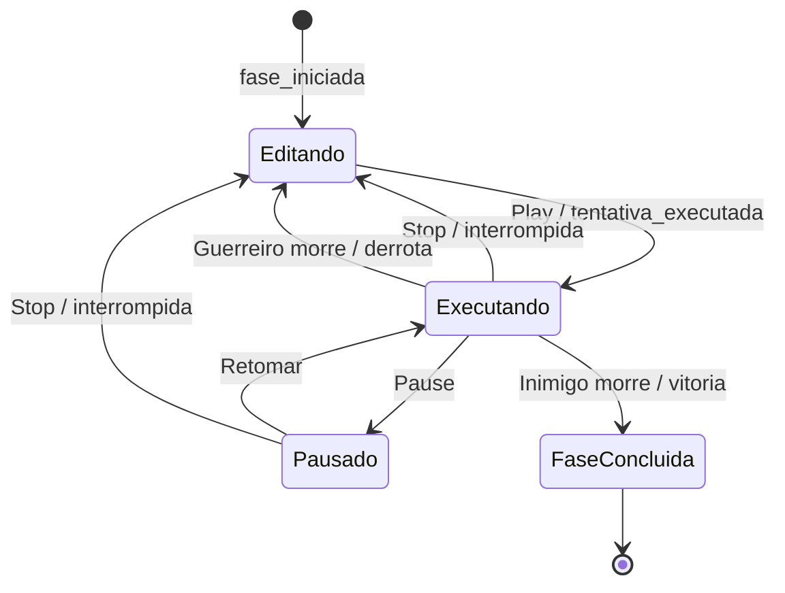

# while under_attack: attack()
## Contrato de Eventos do Jogo

**Status:** Em revisão · **Versão do contrato:** `schema_version = 1`
**Última atualização:** 16/11/2026

Este documento define **o que o jogo envia**. Para onde ele envia está em
[`08-API-e-Integracao.md`](08-API-e-Integracao.md):

> **`POST http://localhost:8001/api/eventos`**, com
> `Authorization: Bearer <token>` e corpo `{"eventos": [ ... ]}`.
>
> A porta é a **8001**, do back-end. A 8000 é a API do BI e **não** recebe
> eventos.

> **Em 18/11/2026 as duas pontas existem e conversam.** O back-end implementa
> este contrato campo por campo, o jogo envia a partir de
> `src/telemetry/telemetry.ts`, e uma partida jogada no navegador percorreu
> EV-01 a EV-05 até a gold, sem evento rejeitado. Esse teste rodou num Postgres
> local: no banco do projeto a bronze ainda só tem o que o gerador sintético
> pôs lá, com `origem = 'sintetico'` (RS-02).

---

## 1. Ciclo de uma fase



**Como ler:** cada Play inicia uma tentativa (RN-007). A tentativa termina numa
das três setas que saem de `Executando` ou `Pausado` e gera um
`tentativa_finalizada`. Se o programa acabar com o inimigo vivo, a execução
continua até o guerreiro morrer (RN-008). Ainda não está definido se editar
durante a pausa encerra a tentativa (PD-008).

---

## 2. Envelope comum

Todo evento tem este formato:

| Campo | Tipo | Obrigatório | Regra |
|---|---|---|---|
| `event_id` | string (UUID v4) | sim | Gerado pelo jogo. Único. Usado para descartar duplicatas (RN-015). |
| `event_type` | string | sim | Um dos tipos da seção 3. |
| `schema_version` | inteiro | sim | Versão deste contrato. Hoje: `1`. |
| `catalog_version` | string | sim | Versão do catálogo de fases usada pelo jogo (ADR-006). |
| `game_version` | string | sim | Versão do jogo (ex.: `0.3.0`). |
| `session_id` | string (UUID v4) | sim | Gerado no início da sessão. |
| `seq` | inteiro ≥ 1 | sim | Contador crescente dentro da sessão (ADR-007). |
| `occurred_at` | string ISO 8601 UTC | sim | Relógio do celular. Pode estar errado, por isso existe o `seq`. |
| `payload` | objeto | sim | Conteúdo específico do tipo. |

**Campos que o jogo não envia:**

- `jogador_id`: a API obtém do token (RN-006).
- `received_at`: a API registra o horário de recebimento. **Não sobrescrever** —
  o ETL ordena por ele (RS-05).
- `origem`: a API grava `'jogo'`.
- `lote_id`: a API liga o evento ao lote que o trouxe, se registrar o lote.

---

## 3. Tipos de evento

### EV-01 `sessao_iniciada`

Payload vazio: `{}`.

### EV-02 `sessao_encerrada`

| Campo | Tipo |
|---|---|
| `motivo` | `"logout"` \| `"app_em_segundo_plano"` |

O celular pode fechar o app sem dar tempo de enviar este evento. Por isso a
camada silver também encerra a sessão após **30 minutos** sem eventos (valor
proposto). Este evento é um complemento, não a única fonte.

### EV-03 `fase_iniciada`

| Campo | Tipo | Regra |
|---|---|---|
| `fase_id` | string | Deve existir no catálogo da `catalog_version` informada. |

### EV-04 `tentativa_executada`

Enviado quando o jogador aperta Play.

| Campo | Tipo | Regra |
|---|---|---|
| `tentativa_id` | string (UUID v4) | Gerado no Play. Liga este evento ao EV-05. |
| `fase_id` | string | |
| `programa` | objeto | Formato na seção 4. |
| `tempo_edicao_ms` | inteiro ≥ 0 | Tempo desde o início da fase ou o fim da tentativa anterior até este Play. |
| `disparo` | `"jogador"` \| `"tempo_esgotado"` \| null | Opcional. Indica quem disparou a execução da tentativa (Play do jogador ou tempo de edição esgotado). |

**Não enviar** o número da tentativa nem a quantidade de blocos. Os dois são
calculados na silver a partir dos dados acima, para não existirem duas versões
do mesmo número.

> **O `programa` é o campo mais importante do contrato.** É dele que saem a
> contagem da RN-014, a tabela `silver.programa_bloco` e o indicador de
> conceito aplicado (RN-019). Deve ser gravado **exatamente como veio**, sem
> achatar nem reordenar: é por guardá-lo inteiro que qualquer indicador novo
> pode ser calculado sobre o passado (ADR-005).

#### O campo `disparo` (RN-021)

**Acrescentado em 17/11/2026, a pedido do lado do jogo.** A fase vai ter tempo
limite: se o jogador não apertar Play em 15 s, **o jogo aperta sozinho** e
manda o programa que estiver no Workspace — que pode estar vazio, ou pela
metade.

Sem distinguir os dois casos, essa tentativa entra nos indicadores como se
fosse uma tentativa do jogador. Medido com dois jogadores que montaram
**exatamente o mesmo programa vencedor**, um deles depois de dois Play
automáticos:

| Indicador | Sem Play automático | Com dois, sem o campo |
|---|---|---|
| Tentativas até vencer (RN-012) | 1 | **3** |
| Derrotas por programa curto (RN-008) | 0 | **2** |
| Tempo montando | 21 s | **51 s** |

Com o campo preenchido, os três voltam a 1, 0 e 21 s — iguais a quem não
estourou o tempo. A tentativa **continua registrada** em
`gold.fato_tentativa` e no `total_tentativas`: ela aconteceu, só não conta
como aprendizagem.

**É campo opcional e aditivo: `schema_version` continua 1.** Evento **sem o
campo**, ou com ele em **`null`**, é tratado como `"jogador"` — que era o único
caso antes de existir tempo limite. Os dois caminhos foram testados contra o
back-end e chegam na silver como `jogador`. Qualquer outro valor é **recusado
na ingestão** (`Input should be 'jogador' or 'tempo_esgotado'`), e não entra na
bronze: o valor é validado na porta justamente porque a bronze é imutável
(RN-016) e não dá para corrigir depois.

> **Por que não dá para deduzir sem o campo.** Um Workspace vazio se reconhece
> por `qtd_blocos = 0`. Mas o tempo pode estourar com o jogador no meio da
> montagem, e aí o programa tem blocos e fica **indistinguível** de uma
> tentativa deliberada. O `tempo_edicao_ms` perto de 15000 também não serve:
> um jogador pode genuinamente levar 15 s. Só o jogo sabe quem apertou o botão.

### EV-05 `tentativa_finalizada`

| Campo | Tipo | Regra |
|---|---|---|
| `tentativa_id` | string (UUID v4) | Mesmo valor do EV-04. |
| `fase_id` | string | |
| `resultado` | `"vitoria"` \| `"derrota"` \| `"interrompida"` | RN-007 a RN-010. |
| `duracao_execucao_ms` | inteiro ≥ 0 | Do Play ao fim, descontando o tempo em pausa. |
| `vida_guerreiro_final` | inteiro ≥ 0 | |
| `vida_inimigo_final` | inteiro ≥ 0 | |
| `programa_concluido` | booleano | `true` se todos os blocos já tinham executado quando a tentativa terminou. |
| `bloco_em_execucao_id` | string \| null | id da instância que executava no fim. `null` se `programa_concluido = true`. |

Os dois últimos campos permitem distinguir duas causas de derrota: o programa
falhou num bloco específico, ou o programa era curto demais e o inimigo atacou
depois (RN-008).

> **O `tentativa_id` do EV-05 tem de ser o mesmo do EV-04.** É o único vínculo
> entre o programa que o jogador montou e o resultado que ele obteve — sem ele,
> a silver não consegue casar os dois e a tentativa não vira linha em
> `gold.fato_tentativa`. Na prática: gerar o UUID no Play, **guardá-lo** na cena
> e reusá-lo no fim da tentativa, nunca gerar um novo.
>
> O back-end **não** verifica isso, porque um lote pode trazer o EV-04 e o EV-05
> separados, e exigir a ordem quebraria o reenvio. A conferência é da silver.

> **Programa vazio.** Quando o Play automático dispara com o Workspace vazio,
> o EV-05 sai com `programa_concluido = true` e `bloco_em_execucao_id = null`
> — não havia bloco para executar. Isso é coerente com o contrato e o ETL
> trata sem erro: `qtd_blocos`, `qtd_pilhas_executaveis` e `profundidade_max`
> ficam em zero, `causa_derrota` fica `programa_curto`, e nenhuma das 10
> regras do gate reclama (testado em 17/11/2026 injetando os eventos na
> bronze). Não há divisão por zero: a eficiência da RN-014 só é calculada
> quando o programa da primeira vitória tem pelo menos um bloco.

O back-end recusa um EV-05 com `programa_concluido = true` e
`bloco_em_execucao_id` preenchido, com o motivo na resposta `207`. É a única
regra de coerência entre campos que ele aplica.

---

## 4. Formato do programa

```json
{
  "pilhas": [
    [
      { "id": "b1", "tipo": "on-flag" },
      { "id": "b2", "tipo": "advance" },
      { "id": "b3", "tipo": "repeat", "corpo": [
        { "id": "b4", "tipo": "if-else", "corpo": [
          { "id": "b5", "tipo": "attack" }
        ] },
        { "id": "b6", "tipo": "advance" }
      ] }
    ]
  ]
}
```

| Campo | Regra |
|---|---|
| `pilhas` | Lista de pilhas do Workspace, **incluindo as que não começam com bloco de evento**. Quais pilhas executam: RN-018 e PD-009. |
| `id` | Único dentro do programa. Pode ser reiniciado a cada tentativa. |
| `tipo` | Deve existir no catálogo de blocos. |
| `corpo` | Obrigatório nos blocos em C (`repeat`, `if-else`): os blocos de dentro. |
| `params` | Opcional. **Nenhum bloco tem parâmetro hoje** — ver seção 6. |
| `condicao` | **Não usado.** O jogo não tem condições; ver seção 6. |
| `senao` | **Reservado.** Ver seção 6. |

> **Os identificadores do exemplo acima são os reais do jogo**, tirados de
> `src/model/defaultCatalog.ts`. Até 16/11/2026 este documento usava nomes
> propostos (`ao_clicar_em_play`, `andar`, `atacar`, `se`, `repetir`,
> `enquanto`) que nunca existiram no código.

---

## 5. Exemplo completo (EV-05)

```json
{
  "event_id": "7f3c2a10-4b8e-4d2a-9c1f-2e6b8a9d0c11",
  "event_type": "tentativa_finalizada",
  "schema_version": 1,
  "catalog_version": "2026.11.2-rascunho",
  "game_version": "0.3.0",
  "session_id": "c0a8e7d2-1f4b-4e6a-8d3c-5b9f2a7e1d40",
  "seq": 14,
  "occurred_at": "2026-11-18T18:22:31Z",
  "payload": {
    "tentativa_id": "a91d4f62-3c7e-4b18-b5a0-6e2c8d1f9b73",
    "fase_id": "F04",
    "resultado": "derrota",
    "duracao_execucao_ms": 8400,
    "vida_guerreiro_final": 0,
    "vida_inimigo_final": 20,
    "programa_concluido": false,
    "bloco_em_execucao_id": "b3"
  }
}
```

---

## 6. O que está em aberto neste contrato

Esta seção existe porque o status do documento é **Em revisão**, e estas são as
revisões que faltam. Todas dependem do jogo.

| | Situação | Pendência |
|---|---|---|
| **De onde vem o `fase_id`** | As fases estão sendo criadas no jogo. Falta combinar se os identificadores saem do `catalogo-fases.json` (o que a ADR-006 previa) ou do código do jogo. O back-end **não** confere isso: ele só valida que é string não vazia. Um `fase_id` fora do catálogo da `catalog_version` informada vai para a quarentena da silver — nada se perde, mas só aparece no dashboard depois de reprocessar | **PD-018** |
| **`corpo` × `inner`** | **Resolvido em 16/11/2026: fica `corpo`, e o jogo traduz.** O back-end aceita `corpo`, como este contrato sempre disse, e isso foi verificado com um programa aninhado gravado e reprocessado. O `BlockInstance` do jogo continua com `inner`: a conversão é feita no jogo, ao serializar o programa | PD-014 ✔ |
| **`condicao`** | O `BlockTemplate` do jogo tem só `id`, `label`, `color` e `shape`: não há condição para escolher, nem no `if-else`. O campo fica fora do contrato até existirem condições | PD-013 |
| **`senao`** | O rótulo do bloco diz "Se / Senão", mas o `BlockInstance` tem um único `inner` — não há ramo senão no modelo de dados. O campo continua reservado | PD-013 |
| **`params`** | Nenhum bloco tem parâmetro editável. O `repeat` é "Repetir 3x" fixo, registrado no catálogo como `vezes_fixas: 3`. Se virar parâmetro, passa a `params.vezes` | PD-013 |
| **Dois blocos de evento** | O jogo tem `on-flag` e `on-start`. Com mais de uma pilha executável, quais executam e em que ordem? | PD-009 |

---

## 7. Validação

- Evento com envelope inválido, `event_type` desconhecido ou payload fora deste
  contrato: **rejeitado** pela API.
- `event_id` repetido: **aceito sem erro e não gravado de novo** (RN-015). Não
  devolver erro no duplicado — se devolver, o jogo nunca tira o evento da fila
  e fica reenviando para sempre.
- Mudança incompatível neste contrato: incrementar `schema_version` e registrar
  no histórico abaixo.

**Implementado em 16/11/2026.** O lote pode trazer um evento ruim no meio de
bons, então o back-end responde sempre **`207`** com o resultado por evento, em
vez de derrubar o lote inteiro:

```json
{ "gravados": 11, "ignorados": 2, "rejeitados": [
    { "event_id": "...", "motivo": "event_type desconhecido" } ] }
```

- `ignorados` são os duplicados — o jogo trata como sucesso e tira da fila.
- `rejeitados` o jogo também tira da fila, porque reenviar não vai consertar.

As três contagens são as mesmas colunas de `bronze.ingestao_lote`, e foi
verificado que batem.

> **Cuidado ao implementar o lado do jogo:** o back-end responde `207` mesmo
> quando *todos* os eventos foram rejeitados. `207` significa "o lote foi
> processado", não "deu tudo certo" — quem decide é o conteúdo da resposta. Um
> `401` ou um erro `5xx`, ao contrário, não processaram nada: nesses o lote
> deve **ficar** na fila.

---

## Histórico

| Versão | Data | Mudança |
|---|---|---|
| 1 | 13/10/2026 | Versão inicial (rascunho) |
| 1 | 13/10/2026 | Categorias de bloco confirmadas; campo `condicao` adicionado ao formato do programa |
| 1 | 16/11/2026 | Identificadores de bloco do exemplo trocados pelos reais do jogo. Nova seção 6 com o que está em aberto. `condicao` e `params` marcados como não usados; `corpo` × `inner` registrado como **PD-014** e a origem do `fase_id` como **PD-018**. Acrescentados `origem` e `lote_id` aos campos que o jogo não envia, e o formato `207` à validação. **Sem mudança incompatível: `schema_version` continua 1** |
| 1 | 16/11/2026 | **O back-end implementou este contrato e ele foi testado de ponta a ponta.** Acrescentado no topo para onde o jogo envia (porta **8001**, não 8000). **PD-014 resolvida:** fica `corpo`, o jogo traduz o `inner`. O `207` deixa de ser sugestão e passa a estar implementado, com o aviso de que ele não significa sucesso. Novo aviso sobre reusar o `tentativa_id` entre EV-04 e EV-05. Registrado o que o back-end **não** valida: `catalog_version`, `fase_id` e coerência entre eventos ficam para a silver. **Sem mudança incompatível: `schema_version` continua 1** |
| 1 | 17/11/2026 | **Campo opcional `disparo` no EV-04** (`"jogador"` ou `"tempo_esgotado"`), para o tempo limite da fase: sem ele, o Play que o jogo dá sozinho conta como tentativa do jogador e triplica o indicador de tentativas até vencer. Registrado o que acontece com programa vazio, testado de ponta a ponta. **Aditivo e opcional: `schema_version` continua 1** |
| 1 | 18/11/2026 | Aviso do topo atualizado: as duas pontas existem e conversam, e uma partida jogada no navegador chegou à gold. O que falta é partida jogada no banco do projeto, não código — ver RS-02 |
