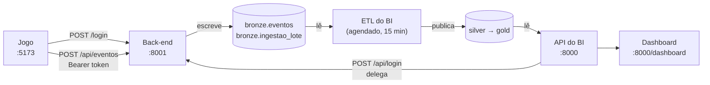

# while under_attack: attack()
## API e Integração entre o Jogo, o Back-end e o BI

**Status:** Ativo · **Última atualização:** 16/11/2026

Este documento descreve **as rotas que existem de verdade** e como as três
partes do sistema se encaixam. Tudo o que está aqui foi verificado rodando em
16/11/2026, com o back-end da branch `mateo/backend-ingestao` e o BI da branch
`bi/inteligencia-de-negocios`.

> **Por que este documento existe.** O Contrato de Eventos
> ([`05`](05-Contrato-de-Eventos.md)) define *o que* o jogo envia. Ele não diz
> *para onde*. Essa lacuna já causou um erro real: as duas instruções que
> circularam na equipe em 16/11 apontavam o jogo para a porta errada. A
> seção 7 registra isso.

---

## 1. São três serviços, não um

| Serviço | Porta | Dono | O que faz |
|---|---|---|---|
| **Jogo** | 5173 (Vite) | Mateo | Palette, Workspace, execução. É quem **envia** eventos |
| **Back-end** | **8001** | Mateo / Lara | Autentica e **recebe** eventos; grava na bronze |
| **BI** | **8000** | Heloisa | Lê gold e serve os dois dashboards |

As três conversam assim:



**A fronteira entre o back-end e o BI é o banco, não uma biblioteca.** Não há
código compartilhado entre `backend/` e `bi/`. O back-end escreve na bronze; o
BI só lê dela (RN-016). A única exceção é o login, que o BI **delega** por HTTP
ao back-end em vez de duplicar a conferência de senha (ADR-004).

### O que cada serviço precisa para subir

| | Back-end (`backend/`) | BI (`bi/`) |
|---|---|---|
| `WUA_DB_URL` | o mesmo banco | o mesmo banco |
| `WUA_SEGREDO` | **a mesma string nos dois** | **a mesma string nos dois** |
| `WUA_BACKEND_URL` | — | `http://localhost:8001` |
| Porta | 8001 | 8000 |

> **O `WUA_SEGREDO` idêntico nos dois `.env` não é detalhe de configuração: é
> requisito de funcionamento.** O back-end assina o JWT com ele; o BI valida a
> assinatura com ele. Se os dois valores diferirem, o login responde **200** — o
> back-end confere a senha e emite o token sem problema — e **toda** chamada
> seguinte ao BI responde `401 token invalido`. A falha aparece longe da causa,
> o que a torna difícil de achar.

---

## 2. Rotas do back-end (porta 8001)

Documentação interativa em <http://localhost:8001/docs>.

| Método | Rota | Autenticação | Para quê |
|---|---|---|---|
| `POST` | `/login` | — | usuário e senha → token JWT |
| `GET` | `/eu` | Bearer | identidade lida do token |
| `POST` | `/api/eventos` | Bearer | recebe o lote de eventos do jogo |
| `GET` | `/saude` | — | serviço no ar e banco respondendo |

### `POST /login`

```json
{ "usuario": "teste", "senha": "teste" }
```

Resposta `200`:

```json
{
  "token": "eyJhbGciOiJIUzI1NiIsInR5cCI6IkpXVCJ9...",
  "jogador_id": 2,
  "nome_exibicao": "Teste",
  "perfil": "jogador"
}
```

Usuário inexistente e senha errada devolvem **o mesmo** `401` com
`"usuario ou senha invalidos"`, de propósito: a resposta não revela se a conta
existe. O back-end também confere um hash fictício quando o usuário não existe,
para que o tempo de resposta não entregue a diferença.

O token é um **JWT HS256** com validade de 8 horas
(`WUA_TOKEN_VALIDADE_HORAS`), e carrega `sub`, `jogador_id`, `usuario`,
`perfil`, `iat` e `exp`.

### `POST /api/eventos`

O corpo é um objeto com a lista na chave `eventos` — **não** uma lista solta:

```json
{ "eventos": [ { "...envelope EV-01..." }, { "...envelope EV-04..." } ] }
```

Cabeçalho obrigatório: `Authorization: Bearer <token>`. Sem ele, `401`.

Responde **sempre `207 Multi-Status`**, no formato que a seção 7 do Contrato de
Eventos propôs:

```json
{
  "gravados": 5,
  "ignorados": 1,
  "rejeitados": [
    { "event_id": "0688c2b3-...", "motivo": "event_type desconhecido" },
    { "event_id": "11f43ff1-...", "motivo": "payload invalido (sessao_encerrada): motivo: Input should be 'logout' or 'app_em_segundo_plano'" },
    { "event_id": "", "motivo": "evento deve ser um objeto JSON" }
  ]
}
```

- **`gravados`** — entraram na bronze agora.
- **`ignorados`** — `event_id` que já existia. **Não é erro** (RN-015): o jogo
  tira da fila, porque reenviar nunca vai mudar o resultado.
- **`rejeitados`** — não passaram na validação, cada um com o motivo. O jogo
  também tira da fila, porque reenviar não conserta um evento malformado.

**Um evento ruim não derruba o lote.** Os bons do mesmo lote são gravados.

### `GET /eu` e `GET /saude`

`/eu` devolve `jogador_id`, `usuario`, `nome_exibicao` e `perfil` do token.
`/saude` devolve `{"status": "ok", "banco": "ok"}` sem autenticação, e `503`
quando o Postgres não responde — é o que um monitor externo consulta.

---

## 3. Rotas do BI (porta 8000)

Documentação interativa em <http://localhost:8000/docs>. Dashboard em
<http://localhost:8000/dashboard/>.

**Nenhuma destas rotas recebe eventos.** O BI é só leitura sobre a gold.

### Acesso

| Método | Rota | Autenticação | Para quê |
|---|---|---|---|
| `POST` | `/api/login` | — | repassa ao `POST /login` do back-end e devolve o mesmo token |
| `GET` | `/api/eu` | Bearer | identidade do token |
| `GET` | `/api/saude` | — | serviço no ar e banco respondendo |
| `GET` | `/api/catalogo` | Bearer | rótulos e categorias dos blocos (o dashboard não mantém uma segunda lista) |
| `GET` | `/api/conceitos` | Bearer | conceitos do catálogo, em ordem de ensino |

Quando o back-end está fora do ar, `POST /api/login` responde `503`
`"servico de autenticacao indisponivel"`, e não `401` — a diferença importa
para saber se o problema é senha errada ou serviço parado.

### Tela do Jogador (RN-004: só os próprios dados)

| Método | Rota |
|---|---|
| `GET` | `/api/jogador/{jogador_id}/resumo` |
| `GET` | `/api/jogador/{jogador_id}/progresso` |
| `GET` | `/api/jogador/{jogador_id}/conceitos` |
| `GET` | `/api/jogador/{jogador_id}/linha-do-tempo` |
| `GET` | `/api/jogador/{jogador_id}/onde-travou` |

Um jogador pedindo o `jogador_id` de outro recebe **`403`**. Um professor
recebe `200` em qualquer um (RN-005).

### Tela do Professor (RN-005: somente perfil `professor`)

| Método | Rota |
|---|---|
| `GET` | `/api/professor/resumo` |
| `GET` | `/api/professor/jogadores` |
| `GET` | `/api/professor/funil` |
| `GET` | `/api/professor/heatmap` |
| `GET` | `/api/professor/atividade` |
| `GET` | `/api/professor/destaques` |
| `GET` | `/api/professor/blocos-problematicos` |
| `GET` | `/api/professor/vitoria-por-tentativa` |

Um jogador em qualquer uma destas recebe **`403`**.

### Operação (somente professor)

| Método | Rota | Para quê |
|---|---|---|
| `GET` | `/api/qualidade` | boletim das 10 regras do gate da última execução (ADR-010) |
| `GET` | `/api/execucoes` | histórico de execuções do ETL, com duração e linhas por etapa |
| `GET` | `/api/ingestao` | contagens de `bronze.ingestao_lote`: lotes, recebidos, gravados, ignorados, rejeitados |
| `GET` | `/api/procedencia` | de onde vem cada número do dashboard |

> **As permissões RN-004 e RN-005 vivem num lugar só**, em
> `bi/src/wua_bi/api/auth_provisoria.py` (`exigir_acesso_a` e
> `exigir_professor`). O back-end **não** as duplica — é o que a ADR-001 pedia.

---

## 4. O caminho completo de um evento

1. **O jogo faz login** no back-end e guarda o token. O `jogador_id` sai do
   token, nunca do corpo do evento (RN-006).
2. **O jogo enfileira** os eventos localmente e envia em lote (ADR-007). O
   evento só sai da fila depois da confirmação.
3. **O back-end valida** envelope e payload com Pydantic, abre uma linha em
   `bronze.ingestao_lote`, grava os válidos em `bronze.eventos` apontando para
   o lote, e fecha o lote com as três contagens — **tudo na mesma transação**.
4. **O ETL do BI** (agendado a cada 15 minutos, ADR-009) lê a bronze e constrói
   silver e gold dentro de uma transação, com gate de qualidade entre as camadas
   (ADR-010): se uma regra reprovar, nada é publicado e a gold fica na última
   versão aprovada.
5. **O dashboard** lê a gold pela API do BI.

### O que o back-end **não** valida (e por quê)

| Campo | O back-end | Quem decide de fato |
|---|---|---|
| `catalog_version` | só confere que é string não vazia; grava o valor original | a silver, ao casar com o catálogo |
| `fase_id` | só confere que é string não vazia | a silver: um `fase_id` fora do catálogo vai para **quarentena** |
| `occurred_at` | aceita qualquer data válida | o ETL ordena por `received_at` e `seq`, não pelo relógio do celular (RS-05) |
| `origem` | **ignora** o que vier no corpo e usa o padrão `'jogo'` do banco | o banco (RS-02) |
| `jogador_id` | **ignora** o que vier no corpo e usa o do token | o token (RN-006) |

Essa divisão é de propósito: o back-end não precisa conhecer o catálogo de
fases para funcionar, e a bronze guarda o que o jogo mandou sem julgar
(ADR-005). **Nada se perde na quarentena** — a bronze é imutável e o
reprocessamento traz o evento de volta quando o catálogo acertar.

### Quarentena não é descarte

Um `fase_id` que não existe no catálogo da `catalog_version` informada não
aparece no dashboard, mas continua gravado na bronze. Corrigir o catálogo e
rodar o ETL de novo é o bastante. É por isso que a **PD-018** (de onde o jogo
tira o `fase_id`) vale resolver antes de o jogo começar a enviar, e não depois.

---

## 5. Contas e senhas

As contas são criadas por script, sem autocadastro (RN-001, ADR-004):

```bash
cd backend && cp contas.example.json contas.json
.venv/bin/python -m wua_backend.seed
```

O seed valida a RN-003 (`nome_exibicao` é primeiro nome ou apelido, nunca nome
completo), gera o hash com **bcrypt custo 12** e usa
`on conflict (usuario) do nothing` — **pode rodar quantas vezes quiser sem
duplicar nem sobrescrever** contas existentes.

`backend/contas.json` tem senhas em texto e **está no `.gitignore`**. Nunca
comitar.

### Contas que existem hoje no banco do projeto

| `jogador_id` | Usuário | Perfil | Senha |
|---|---|---|---|
| 2 | `teste` | jogador | igual ao usuário |
| 3 | `professor` | professor | igual ao usuário |

> **Senha igual ao usuário é convenção de teste e só vale enquanto nada está
> publicado.** No dia em que a API for para o Render, essas senhas viram
> adivinháveis por qualquer pessoa. Trocar antes de publicar — ver PD-005.

### A troca de PBKDF2 para bcrypt não é retroativa

Em 16/11/2026 o hash dessas duas contas foi **refeito em bcrypt**. Elas tinham
sido criadas com PBKDF2 pela autenticação provisória do BI, e o
`bcrypt.checkpw` do back-end recusa esse formato: o login falhava sem erro
visível. Como o seed não sobrescreve conta existente, rodá-lo não corrigiria —
foi preciso trocar o hash direto no banco:

```sql
update app.jogador set senha_hash = '<hash bcrypt>' where usuario = 'teste';
```

**O gerador de dados sintéticos do BI tinha o mesmo problema**, e foi corrigido
no mesmo dia. O `wua_bi.etl semear` cria 11 contas de desenvolvimento (`ana`,
`bruno`, …, `professor`) e gerava o hash em PBKDF2: nenhuma delas conseguiria
entrar. Agora ele usa **bcrypt custo 12**, o mesmo do seed do back-end, e as
contas que ele cria são indistinguíveis das criadas por lá. Verificado: login de
`ana` e `professor` responde `200`.

Se aparecer uma conta que não entra com a senha certa, é isso. Para descobrir:

```sql
select usuario, left(senha_hash, 4) from app.jogador;
```

Hash bcrypt começa com `$2b$`. Qualquer coisa com 64 caracteres hexadecimais é
PBKDF2 antigo e precisa ser refeito.

---

## 6. Como subir tudo

Três terminais. O banco é o mesmo para os dois serviços Python.

```bash
cd backend && .venv/bin/python -m uvicorn wua_backend.main:app --reload --port 8001
```

```bash
cd bi && .venv/bin/python -m uvicorn wua_bi.api.main:app --reload --port 8000
```

```bash
npm run dev
```

Ordem importa só para o login: **o dashboard não autentica sem o back-end no
ar**, porque delega. A leitura da gold funciona independente.

Para conferir que os dois subiram e falam com o banco:

```bash
curl -s localhost:8001/saude && echo && curl -s localhost:8000/api/saude
```

Os dois devem responder `{"status":"ok","banco":"ok"}`.

### Estado de transição em 16/11/2026: o login só funciona com as duas branches juntas

Enquanto o back-end não estiver na `main`, **o login depende de qual branch
está no diretório de trabalho**:

| Branch | `POST /api/login` |
|---|---|
| `mateo/backend-ingestao` | **funciona** — tem a delegação ao back-end e o back-end |
| `bi/inteligencia-de-negocios` | **`401`** — o código ainda confere a senha com PBKDF2, e os hashes do banco são bcrypt |
| `main` | não tem nem um nem outro |

Isso não é defeito de nenhum dos dois lados: a conferência de senha **mudou de
lugar**, saiu do BI e foi para o back-end, e o hash no banco acompanhou. As duas
metades da mudança estão em PRs diferentes.

**A ordem de merge importa:** a PR #3 foi aberta a partir da branch do BI, então
ela contém as duas coisas. Mergear a **#1 primeiro** e a **#3 depois** deixa
cada PR com o seu próprio diff e o histórico legível. Mergear só a #3 também
funciona, mas joga o trabalho do BI para dentro dela.

Até isso acontecer, as rotas de **leitura** da gold funcionam normalmente em
qualquer branch — só a autenticação depende do back-end.

---

## 7. Três informações erradas que circularam na equipe em 16/11/2026

Esta seção existe porque os assistentes que ajudam a equipe passaram informação
errada sobre esta API, e a primeira delas quebraria o jogo por inteiro. Ficam
registradas para ninguém repetir.

### 7.1 A porta da ingestão é a 8001, não a 8000

A instrução que circulou para o jogo dizia:

```typescript
export const API_URL = import.meta.env.VITE_API_URL ?? 'http://localhost:8000';
```

**Está errado.** A porta 8000 é a API do BI, que **não tem** essas rotas —
confirmado: `POST localhost:8000/api/eventos` responde `404` e
`POST localhost:8000/login` responde `404`. O jogo tem de apontar para a
**8001**:

```typescript
export const API_URL = import.meta.env.VITE_API_URL ?? 'http://localhost:8001';
```

E no `.env` do jogo, `VITE_API_URL=http://localhost:8001`.

O caminho da ingestão, `/api/eventos`, e o formato do corpo,
`{"eventos": [...]}`, estavam corretos.

### 7.2 Não há como marcar um evento como `sintetico` pelo back-end

A mesma instrução sugeria, para testar sem contaminar os números reais:
*"mantenha o back-end em origem `sintetico`"*.

**Isso não é possível.** O back-end ignora qualquer `origem` que venha no corpo
e deixa o banco aplicar o padrão `'jogo'` — verificado enviando
`origem: "sintetico"` num evento e lendo `'jogo'` no banco. É o comportamento
correto (RS-02), mas significa que a saída sugerida não existe.

Como a bronze é imutável (RN-016), **um evento falso gravado como `'jogo'` não
sai mais** e contamina os indicadores. Para testar sem sujar os dados há dois
caminhos de verdade:

1. **Enviar só os eventos que o jogo já consegue produzir** (EV-01, EV-03 e
   EV-04) e não inventar valores para o EV-05.
2. **Usar o gerador do BI** (`bi/src/wua_bi/gerador.py`), que escreve
   `origem = 'sintetico'` direto no banco e sabe se limpar depois.

### 7.3 O CORS está aberto para qualquer origem, não só para as locais

A descrição que circulou dizia que o `CORSMiddleware` foi configurado *"para
aceitar as origens locais"*. O código é `allow_origins=["*"]` com
`allow_credentials=True`. Verificado: um `OPTIONS` com
`Origin: https://site-qualquer-da-internet.example` recebe `200` e
`access-control-allow-origin` com essa mesma origem.

Para o desenvolvimento o efeito prático é o desejado — a porta 5173 do Vite
funciona. Mas a descrição não corresponde ao código, e **antes de publicar a
lista precisa virar explícita**, com as origens do jogo e do dashboard. Fica
registrado como pendência de implantação (PD-005).

---

## 8. O que falta para o caminho ficar completo

Atualizado em 17/11/2026, depois de o jogo ganhar o módulo de telemetria e de o
back-end aceitar o campo `disparo`.

| | Situação |
|---|---|
| Rotas de login e ingestão | **prontas e testadas** |
| Gravação na bronze com controle de lote | **pronta e testada** |
| Campo `disparo` do EV-04 (RN-021), nas três camadas | **pronto e testado** |
| ETL, gate de qualidade, gold e dashboards | **prontos e testados** |
| Jogo: montar o envelope, fila local, envio em lote | **pronto** (`src/telemetry/telemetry.ts`) |
| Jogo: serializar o programa em `pilhas` com `corpo` | **pronto** (`src/telemetry/programa.ts`) |
| Jogo: disparar os cinco eventos | **pronto** (`BattleScene`) |
| Jogo: **enviar de verdade** | **falta ligar o login** — ver abaixo |
| Jogo: tempo limite da fase e `disparo` | **falta** |
| Jogo: RN-008, derrota quando o programa acaba curto | **falta** |

### Onde está escrito o que falta

Cada lacuna abaixo tem uma issue com o detalhe de implementação — o que mandar,
em que formato, o que já está pronto do outro lado e como conferir que
funcionou. **Quem for mexer deve ler a issue antes**, porque várias dessas
coisas já foram decididas e testadas, e refazê-las de outro jeito quebra o que
já passa no gate.

| O que falta | Issue | Decisão em aberto |
|---|---|---|
| Tela de login e `iniciarSessao` | [#7](https://github.com/laramaia/while_under_attack/issues/7) | PD-023 |
| Tempo limite da fase e campo `disparo` | [#8](https://github.com/laramaia/while_under_attack/issues/8) | PD-022 |
| EV-05 quando o programa acaba com o inimigo vivo | [#9](https://github.com/laramaia/while_under_attack/issues/9) | — |
| Trocar as senhas de teste antes do deploy | [#10](https://github.com/laramaia/while_under_attack/issues/10) | PD-005 |
| `on-start` na Palette sem executar | [#4](https://github.com/laramaia/while_under_attack/issues/4) | PD-021 |
| Bloco de repetição com condição | [#2](https://github.com/laramaia/while_under_attack/issues/2) | PD-017 |

A ordem importa: **a #7 destrava as outras duas do jogo**. Enquanto a sessão
não abre, nem o tempo limite nem a RN-008 dão para verificar com dado real —
dá para escrever o código, não dá para saber se chegou.

### O fio que falta: ninguém abre a sessão

Issue [#7](https://github.com/laramaia/while_under_attack/issues/7).

`telemetry.registrar()` sai cedo quando não há `session_id`, e `flush()` sai
cedo quando não há token. Os dois só existem depois de
`telemetry.iniciarSessao(token)` — **que não é chamado em lugar nenhum**
(`git grep iniciarSessao` só acha a própria definição).

Na prática: o jogo monta os eventos certinhos e **descarta todos**. Nada entra
na fila, nada é enviado, a bronze continua vazia. O que destrava é a tela de
login do jogo, chamando `iniciarSessao` com o token que o `POST /login`
devolve. Enquanto isso não existir, não dá para ver nenhum número real no
dashboard.

### Dois buracos no que o jogo emite

Issues [#8](https://github.com/laramaia/while_under_attack/issues/8) e [#9](https://github.com/laramaia/while_under_attack/issues/9).

**1. Play sem bloco de evento não gera nenhum evento.** O `BattleScene` faz:

```typescript
if (runner.running || !runner.canRun(roots)) return;
```

e `canRun` exige um `on-flag`. Então, com o Workspace vazio, **não sai EV-04
nem EV-05**. Isso importa para o tempo limite da fase (RN-021): a tentativa que
o jogo dispara sozinho com o Workspace vazio é justamente a que precisa ser
registrada, e hoje ela não seria. Para a derrota por tempo esgotado aparecer no
dashboard, o `onPlay` precisa emitir os eventos mesmo quando não há nada para
executar.

**2. Programa que acaba com o inimigo vivo não gera EV-05.** O `onFinished`
tem:

```typescript
if (!resultado) {
  console.warn('[telemetria] programa acabou com o inimigo vivo: falta a regra RN-008');
  return;
}
```

A RN-008 diz que, nesse caso, a execução continua até o guerreiro morrer — e
aí há derrota. Sem isso, a tentativa fica com EV-04 e sem EV-05.

**O ETL aguenta**, e isso foi testado: a tentativa entra na silver com
`resultado` nulo, **não** entra em `gold.fato_tentativa`, e a reconciliação
`REC-001` continua passando, porque ela conta tentativa na silver, não no
gold. Nenhuma das 10 regras reclama. Mas o jogador fez uma tentativa que não
aparece em lugar nenhum do dashboard, e o `numero_tentativa` das seguintes
pula um — o que desloca a curva de vitória por número da tentativa.

### A PD-014 foi decidida de um lado só, e o jogo seguiu

O back-end aceita **`corpo`** para o conteúdo dos blocos em C, como o Contrato
de Eventos sempre disse. O `BlockInstance` do jogo guarda em `inner`, e o
`serializarPrograma` traduz na hora de enviar — que é exatamente o combinado.
O serializador também devolve um `Map` de bloco para id, que é como o
`bloco_em_execucao_id` do EV-05 aponta para o bloco certo.

---

## Histórico

| Data | Mudança |
|---|---|
| 16/11/2026 | Versão inicial, escrita depois de rodar o back-end da branch `mateo/backend-ingestao` de ponta a ponta contra o BI. Rotas dos dois serviços, caminho completo do evento, divisão de validação entre back-end e silver, exigência do `WUA_SEGREDO` compartilhado, e a seção 7 com os três erros de informação que circularam na equipe |
| 17/11/2026 | **O jogo ganhou telemetria e a PR #1 entrou na `main`.** Seção 8 reescrita: o módulo monta e serializa certo, usa a porta 8001 e reusa o `tentativa_id`, mas **ninguém chama `iniciarSessao`**, então nada é enviado. Registrados dois buracos no que o jogo emite — Play sem bloco de evento não gera evento nenhum, e programa que acaba com o inimigo vivo não gera EV-05 — com o que cada um faz no ETL, testado |
| 17/11/2026 | **O back-end passou a aceitar o campo `disparo`** (PR #3, commit `947580a`), e a cadeia inteira foi testada junta: jogo → back-end → bronze → silver → gold, com as 10 regras do gate aprovando. Campo ausente e `null` explícito chegam os dois como `jogador`; valor fora dos dois é recusado na ingestão. Seção 8 ganhou a tabela do que falta, **com uma issue por lacuna**: quem for implementar deve ler a issue antes, porque o outro lado já está pronto e testado |
